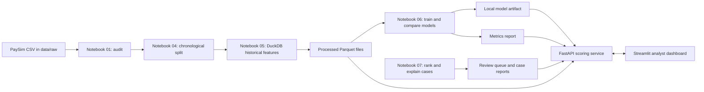

# Architecture overview

## What the project does

This project uses the synthetic PaySim mobile-money dataset to rank transactions for human review. A data-preparation pipeline adds past account activity, a model estimates a risk score, and the dashboard lets a reviewer inspect ranked cases and account history.

The system is a learning prototype. PaySim is simulated data, so its metrics do not establish performance on real payment data.

## Components

## Pipeline in plain language

1. **Audit:** inspect columns, missing values, label balance, transaction types, time range, and the provided system flag.
2. **Split by time:** use early steps for training, the next period for threshold selection, and the latest period for the final evaluation. This better imitates predicting future transactions.
3. **Build historical features:** for each transaction, count and sum the sender's earlier outgoing transactions and receiver's earlier incoming transactions. Current and future transactions are not counted.
4. **Train models:** compare Logistic Regression, Random Forest, and LightGBM; compare LightGBM with and without the account-history features.
5. **Evaluate and rank:** select a decision threshold using the validation period, measure final performance on the later test period, and produce a ranked case queue with feature contributions.
6. **Serve results:** FastAPI exposes scoring, case, metrics, and earlier-network endpoints. Streamlit calls those endpoints and displays the results.

## Local API endpoints

| Method and path | Purpose |
|---|---|
| `GET /health` | Checks that the local model and processed data exist. |
| `POST /score` | Scores one transaction using provided details and account activity before its step. |
| `GET /cases?limit=25` | Returns a limited portion of the ranked review queue. |
| `GET /cases/{risk_rank}` | Returns one case, its model contributions, and its earlier transaction neighborhood. |
| `GET /metrics` | Returns the saved model comparison. |
| `GET /network/{account_id}?before_step=...` | Returns earlier transactions involving an account; labels are excluded. |

Interactive API documentation is available at `/docs` while the API is running locally.

## Leakage and safety controls

- Split boundaries use transaction time steps, not random rows.
- Historical features only include steps strictly earlier than the transaction being scored.
- Model inputs exclude `isFraud`, `isFlaggedFraud`, and raw account identifiers.
- The serving API never reads fraud labels to calculate a new score or account network.
- Scores and queue entries are candidate review signals, not confirmed cases.
- Raw data, processed Parquet files, local environments, and model binaries are excluded from Git.
