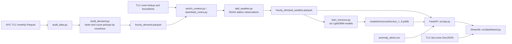

# Project architecture

## How a forecast reaches the dashboard

## Main pieces

- **Data files:** raw trip records, zone lookup, NOAA observations, and taxi-zone polygons. Raw downloads are local and excluded from Git.
- **Preparation scripts:** `audit_data.py` inspects the original file; `build_demand.py` keeps the chosen month and aggregates pickup counts; `enrich_context.py` adds readable zone/calendar fields; `add_weather.py` joins hourly station weather.
- **Model scripts:** `evaluate_baselines.py` compares simple forecasts; `train_horizons.py` builds 1–6 hour LightGBM models and records MAE/RMSE/WAPE; `analyze_forecasts.py` breaks errors down by zone/hour and reports feature importance; `detect_anomalies.py` creates candidate alerts.
- **API:** FastAPI loads processed data and the six saved models. `/forecast/{zone_id}` predicts one zone, `/forecasts` returns a map-ready set, `/history/{zone_id}` returns recent counts, `/anomalies` returns ranked alerts, `/zones` provides labels, and `/health` reports service status.
- **Dashboard:** Streamlit requests forecast/history/alert data from FastAPI, joins bulk predictions to local taxi-zone polygons, and renders the choropleth map and charts.

## Important limits to explain

- Current model evaluation uses one month (January 2024) and a final-week holdout. Results may change across seasons and years.
- Historical observations end at January 31, 2024. Dashboard forecasts are a historical demonstration for February 1, not a current operational forecast.
- Weather is from one Central Park station and is shared across all zones. The model does not receive a forecast of future weather.
- Zone 264 has trips but no matching row in the TLC lookup, so it is labeled Unknown. Newark Airport is outside the taxi-zone boundary map coverage.
- Anomaly alerts are statistical candidates for human review, not verified disruptions.
